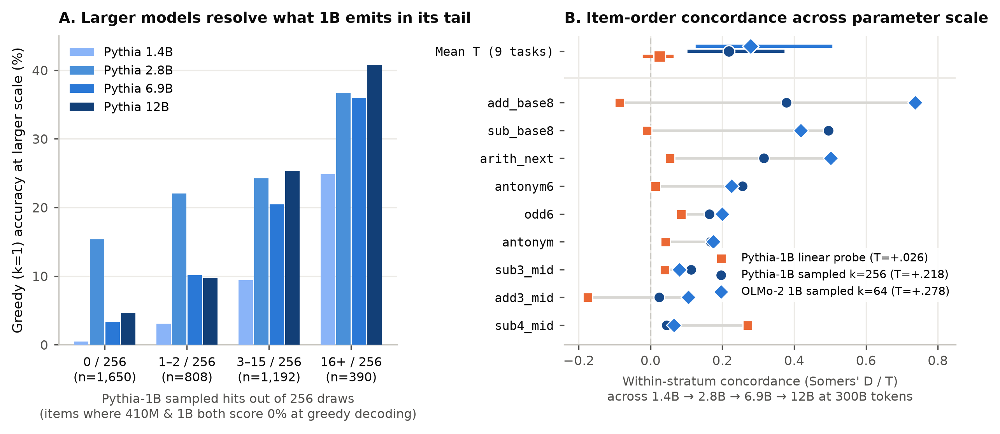
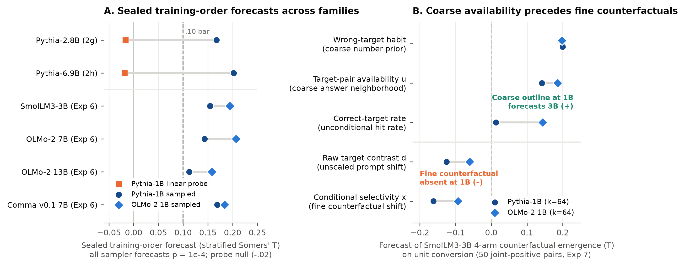

# Decodable Is Not Learned — Supporting Record

Public supporting record for the paper **"Decodable Is Not Learned:
Untrained-Weights Controls and Basis-Starved Splits for Linear
Probing"** (Michael Jordan) and the companion 20-experiment emergence
program:

- **Technical Methods Paper**: [Preprint PDF (`paper/tmlr/preprint.pdf`)](paper/tmlr/preprint.pdf) · [Markdown PDF (`paper/decodable-is-not-learned.pdf`)](paper/decodable-is-not-learned.pdf) · [Markdown source (`paper/decodable-is-not-learned.md`)](paper/decodable-is-not-learned.md) · [LaTeX source (`paper/tmlr/main.tex`)](paper/tmlr/main.tex)
- **Program Summary Figures**: [Figure 1 — Parameter-ladder resolution at fixed 300B tokens (`figures/fig1_parameter_ladder.png`)](figures/fig1_parameter_ladder.png) · [Figure 2 — Cross-family training forecasts & coarse-to-fine decomposition (`figures/fig2_coarse_to_fine.png`)](figures/fig2_coarse_to_fine.png)

This repository is a path-filtered extraction of the private working
repository, preserving full commit history, authorship dates, and
ordering for everything the paper and companion program rely on: the frozen
preregistration documents, the experiments' code, campaign ledgers,
all committed probe fits (480 for Experiment 2, 770 for Experiment 2b,
and Experiment 2c's 220 untrained-gate fits), every raw sampled draw
from the generation and checkpoint-forecast experiments, the frozen
reports, verdicts and retrospectives, and the paper source with the
scripts that generate its figures, Table 1, and Appendix A.

## What is here

- **Experiments 1, 1b, 1c** (added 2026-08-23) — the synthetic
  calibration of the three-signature instrument, reported in the
  companion essay rather than the paper: small transformers trained
  from scratch on a Lubana-style formal language (percolation, no
  structure below threshold by construction) and a modular-arithmetic
  grokking task (latent structure before the transition). Experiment 1
  closed FAIL on an S1 criterion later found to compare raw probe
  accuracy across incommensurable class counts; Experiment 1b re-tested
  the probe leg under an untrained-twin floor and closed PASS (grokking
  9/10, Lubana above threshold 10/10, below 0/10); Experiment 1c swept
  sub-critical graph density and closed FAIL with 0 of 320 trained and
  0 of 480 untrained sites firing, declared underpowered in advance.
  These records live on a separately filtered line merged into this
  history (see PROVENANCE.md); their code is self-contained under
  `experiments/exp1*`.
- **Experiments 2, 2b, 2c** — the probing-hygiene arc the paper is
  about: standard splits and what an untrained network decodes; the
  basis-starved re-run; the screened battery and its inclusion-time
  untrained gate (the paper's Section 7).
- **Experiment 2d** — the probe ladder's prediction re-tested with the
  sampling instrument on Experiment 2c's battery and known outcome:
  a model-free format floor applied to both sides, a pilot-driven
  power declaration (underpowered in advance), gate 1 on the
  production path, and a FAIL read as "not detected at this
  resolution".
- **Experiment 2e** — Experiment 2d's committed draws re-read with the
  format floor as a covariate instead of a threshold (analysis-only,
  zero model contact): a FAIL at a point estimate of .61, which
  settles that 2d's null was not its threshold's.
- **Experiment 2f** — ladder order on the two rungs Experiment 2c's
  probe had read as silent: one label per rung read by probe,
  sampling and argmax on the same weights and items (a LADDER — the
  probe reads the answer's digit in every cell where the generators
  do not; the earlier silence was the label and the split).
- **Experiments 2g, 2h, 2i, 2j, 2k, 2l, 2m, 2n** — the item-grain
  training-order forecast arc: pitting the matched-label 1B linear probe
  directly against the 1B temperature-1 sampled output tail on sealed
  training-checkpoint sweeps across Pythia-2.8B (2g, sampled tail `T = +.170`
  vs probe `-.019`), Pythia-6.9B (2h, `T = +.202` vs probe `-.019`),
  OLMo-2 7B (2i within-lineage `T = +.215`; 2j/2k predictor-density
  bridge at `k=256`, `T = +.155`), OLMo-2 13B (2l sealed cross-family
  forecast `T = +.126` from Pythia-1B and `+.182` from OLMo-2 1B, plus
  heuristic-residual and wrong-answer habit prior `+.18`), SmolLM3-3B
  (2m, `T = +.170` and `+.251`), and Comma v0.1 7B (2n, `T = +.160` and
  `+.210`).
- **Experiments 3a, 3b, 3, 3c, 3d, 3e** — the successor generation arc the
  paper's Section 6 draws its calibration lessons from: a verdict that
  crashed on a valueless input (3a), the same-weights probe/emission
  dissociation (3b), sampling elicitation (3), staged deepening (3c),
  item-grain rank prediction (3d, whose power table mis-specified
  its alternative's shape — the sixth lesson), and the shortcut test
  that closed 3d's named alternative (3e, whose freeze found that an
  exclusion rule's conservative direction is test-relative — the
  seventh lesson).
- **Experiments 4, 4b, 4c** — task-grain representational convergence
  across Pythia, OLMo-2, SmolLM3 and Comma: measuring pre-clear
  agreement growth (4, `.61` raw), calibrating against 10,000 placebo
  batteries of never-performing flat tasks under the identical selection
  rule (4b, placebo `p = .25`, lead `.17` with CI covering zero), and
  testing the rank statistic on sealed Pythia-6.9B and OLMo-2 13B sweeps
  (4c, `U = .45, p = .73`).
- **Experiments 5, 5b** — testing whether matched held-out pre-training
  loss yields matched capability profiles across Pythia's seven sizes
  (21 size pairs from 160M to 12B): finding a significant profile
  discrepancy beyond checkpoint-to-checkpoint wobble on both sides
  (`27.6` items per 500 net of both wobbles, `p = 9e-4`) with no
  directional advantage for larger models (`26` cells favor the larger
  model, `24` favor the smaller).
- **Experiment 6** (added 2026-10-04) — the item-order forecast beyond the
  original synthetic battery: seventeen fresh benchmark-derived rungs,
  Pythia-1b and OLMo-2 1B predictors sealed before 87 checkpoints across
  SmolLM3-3B, OLMo-2 7B, OLMo-2 13B and Comma. **GENERAL: all eight
  primary tests fire**, with strings and choices meeting the breadth
  condition for both predictors. Each p is 1/10,001. Comma reads nine of
  the ten rungs simulated for power; the other six tests read their exact
  sets. The claim concerns item order under these renderings, not which
  tasks clear or a learning mechanism. Complete results and disclosures:
  `experiments/exp6/results/VERDICT.txt` and `retrospective.md`.
- **Experiment 7** (added 2026-10-25) — the counterfactual conditional
  selectivity test on four benchmark-derived task families (`deduction`,
  `shapes`, `units`, `unscrambling`), with 500 four-arm prompt pairs per
  family (two counterfactual prompts flipping the target answer between
  `y` and `y'`, plus sham rewordings of each — 8,000 prompts in all),
  Pythia-1B and OLMo-2 1B predictors sealed at `k=64` before SmolLM3-3B's
  26-checkpoint outcome sweep. Closed **UNDETERMINED
  (`NO-PREDICTOR-JOINT-LICENCE`)**: across all 26 checkpoints, four-arm
  joint-positive pair counts are `units = 50`, `unscrambling = 2`,
  `deduction = 0`, `shapes = 0` (only `units` clears the 20-pair floor,
  $1 < 3$ required families). All-family mean 1B conditional target
  selectivity $\bar{x}$ sits near zero (`-.0016` for Pythia-1B, `+.0100`
  for OLMo-2 1B), and on `units` (50 pairs) 1B conditional target
  contrast $x$ orders 3B joint emergence negatively (`D_units = -.1619`
  for Pythia-1B, `-.0931` for OLMo-2 1B), whereas 1B unconditional
  target-pair availability (`T_u = +.1414, +.1862`) and wrong-target
  habit rate (`T_wrong = +.1996, +.1981`) positively forecast 3B joint
  emergence (`S1`). On `shapes`, individual arms solve `120–125/500`
  prompts (~25%) while four-arm joint positivity is `0/500` (`S6`).
  Complete results and disclosures:
  `experiments/exp7/campaign/statistics/analysis/analysis.json`,
  `experiments/exp7/deployment/trust-verdict.json` and
  `experiments/exp7/retrospective.md`.
- **Matched-token parameter-scale analyses** (added 2026-10-25) —
  zero-model-contact re-analyses of committed cross-scale slices at fixed
  training tokens: `analyses/matched-token` (Experiment 2c's 11-rung
  battery across `Pythia-{410M, 1B, 1.4B, 2.8B, 6.9B}` at `step143000`,
  300B tokens) and `analyses/matched-token-item-order` (item-grain
  parameter-ladder emergence across `Pythia-{1.4B, 2.8B, 6.9B, 12B}` at
  fixed `step143000` from Experiments 2d, 5, and 5b, where `Pythia-1B`
  `k=256` sampling predicts parameter-scale emergence order at mean
  stratified `T = +.2180`, 4/4 `p = 1e-4`, and `OLMo-2 1B` `k=64` at
  `T = +.2782`, 4/4 `p = 1e-4`, while `Pythia-1B` linear probe scores
  `T = +.0259`).

Every experiment whose record ships here carries both its
preregistration and its closeout tag:
`exp1-analysis-frozen` (Experiment 1 predates the `-preregistered` /
`-closed` convention; its closeout is the 2026-07-14 commit that
recorded `experiments/exp1/results/analysis_verdict.txt`),
`exp1b-preregistered` / `exp1b-closed`,
`exp1c-preregistered` / `exp1c-closed` (plus `exp1c-stage-a`, the
power declaration made in advance — the one interim stage tag carried
here; see PROVENANCE.md),
`exp2-preregistered` / `exp2-closed`,
`exp2b-preregistered` / `exp2b-closed`,
`exp2c-preregistered` / `exp2c-closed`,
`exp2d-preregistered` / `exp2d-closed`,
`exp2e-preregistered` / `exp2e-closed`,
`exp2f-preregistered` / `exp2f-closed`, `exp2g-preregistered`, `exp2g-predictor-sealed`, `exp2g-closed`,
`exp2h-preregistered` / `exp2h-closed`,
`exp2i-preregistered`, `exp2i-predictor-sealed`, `exp2i-endpoint-sealed`, `exp2i-closed`,
`exp2j-preregistered` / `exp2j-closed`,
`exp2k-preregistered` / `exp2k-predictor-sealed` / `exp2k-closed`,
`exp2l-preregistered` / `exp2l-endpoint-sealed` / `exp2l-closed`,
`exp2m-preregistered` / `exp2m-endpoint-sealed` / `exp2m-closed`,
`exp2n-preregistered` / `exp2n-endpoint-sealed` / `exp2n-closed`,
`exp3a-preregistered` / `exp3a-closed`,
`exp3b-preregistered` / `exp3b-closed`,
`exp3-preregistered` / `exp3-closed`,
`exp3c-preregistered` / `exp3c-closed`,
`exp3d-preregistered` / `exp3d-closed`,
`exp3e-preregistered` / `exp3e-closed`,
`exp4-preregistered` / `exp4-reference-sealed` / `exp4-closed` (the
preregistration tag re-cut once after a campaign stop; see PROVENANCE.md),
`exp4b-preregistered` / `exp4b-closed`,
`exp4c-preregistered` / `exp4c-closed` (the preregistration tag re-cut
once after a preflight amendment; see PROVENANCE.md),
`exp5-preregistered` / `exp5-targets-sealed` / `exp5-closed` (the targets
seal binds the seven finals, gates 1(a)/(b), the host record and the power
record, cut after the power record; see PROVENANCE.md),
`exp5b-preregistered` / `exp5b-closed`,
`exp6-preregistered` / `exp6-predictor-sealed` / `exp6-endpoint-sealed` /
`exp6-closed`,
`exp7-preregistered` / `exp7-predictor-sealed` / `exp7-closed`.
Other interim stage tags exist only in the private repository. `v1.0`,
`v1.1`, `v1.2`, `v1.3`, `v1.4`, `v1.5`, `v1.6`, `v1.7`, `v1.8`, `v1.9`, `v1.10`, `v1.11`, `v1.12`, `v1.13`, `v1.14`, `v1.15`, `v1.16`, `v1.17`, `v1.18`, `v1.19`, `v1.20`, `v1.21`, `v1.22`, `v1.23`, `v1.24` and `v1.25` anchor the Zenodo-archived snapshots
(concept DOI 10.5281/zenodo.21830421). Every release anchor is immutable,
so each deposit remains exactly what was deposited.

For Experiments 2 and 2b, probe fits appear only in commits after the
corresponding freeze tag — the ordering the paper describes is
checkable in this history. Experiment 2c's untrained screening fits
are frozen WITH its battery by design (they are the inclusion screen,
adjudicated at the freeze); its trained-side fits appear only after
the tag. The generation experiments' committed draws likewise post-date
their freezes. Activation npz files are not committed; their SHA-256
digests are (`experiments/exp2b/results/activations_sha256.txt`).

Commit SHAs here differ from those quoted in the paper's ledgers
(extraction rewrites history); see PROVENANCE.md for the mapping and
the declared redactions.

Release **v1.24**, [10.5281/zenodo.23130840](https://doi.org/10.5281/zenodo.23130840),
adds the Experiment 6 archive. Release **v1.25**,
[10.5281/zenodo.23648247](https://doi.org/10.5281/zenodo.23648247),
adds the Experiment 7 archive and the matched-token parameter-scale
analyses (`analyses/matched-token` and `analyses/matched-token-item-order`).
All 27,600 deposited files were verified against the release tree,
including 835 Experiment 7 paths and 32 matched-token paths. The current
paper inventories all 72 experiment tags and carries the version DOI at
parity in markdown, TeX and its three rebuilt PDFs.

## License

MIT for code, CC BY 4.0 for text and data; see LICENSE.md.
